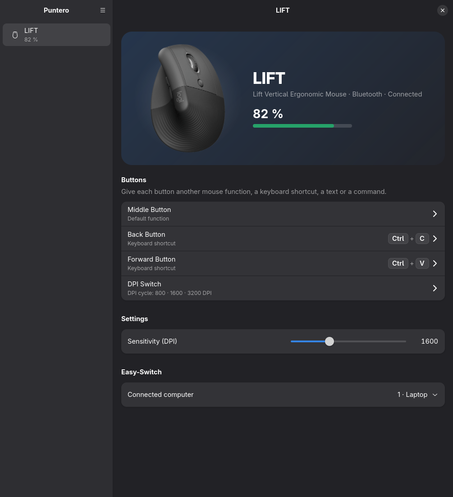
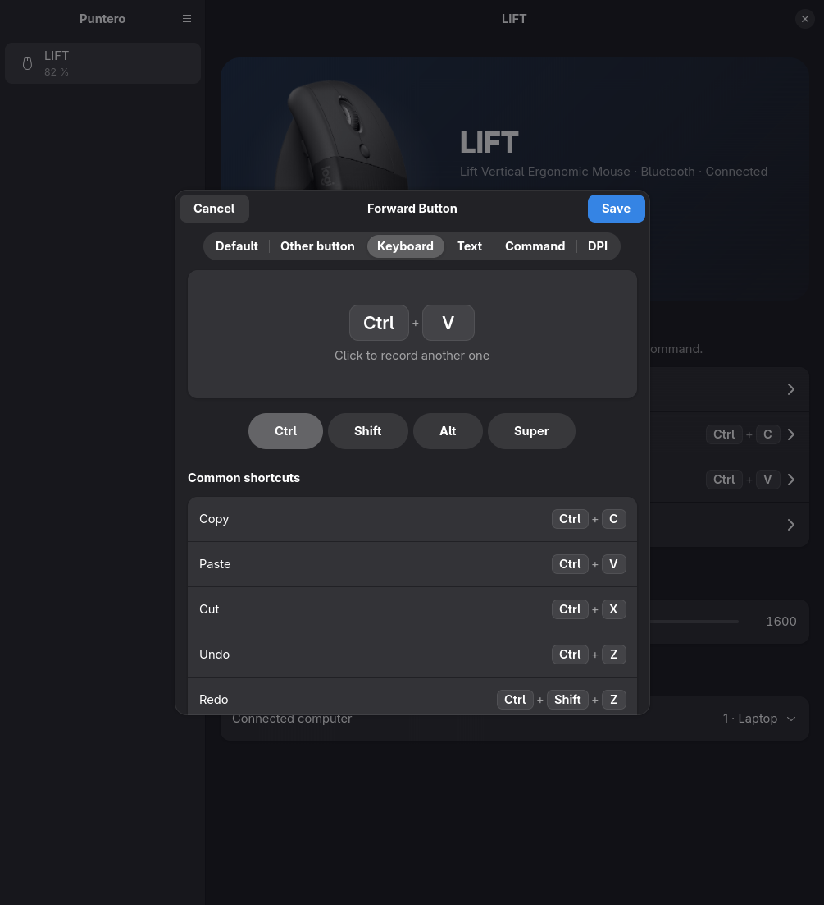
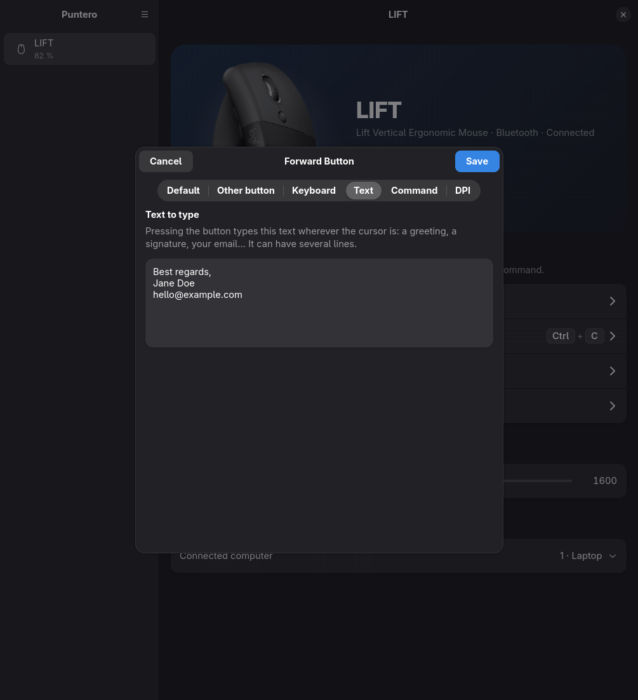
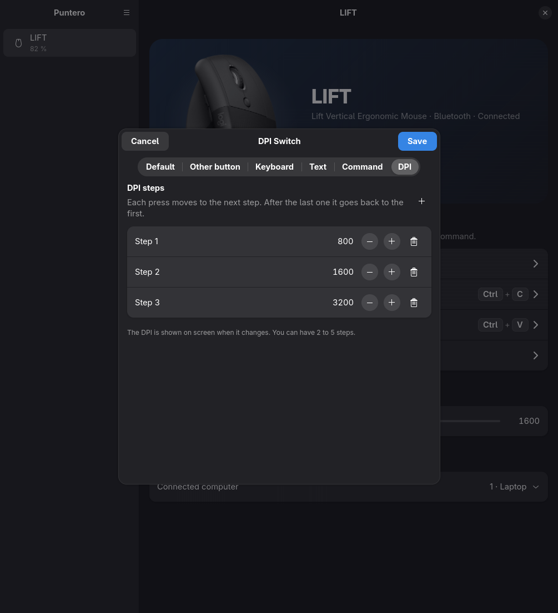
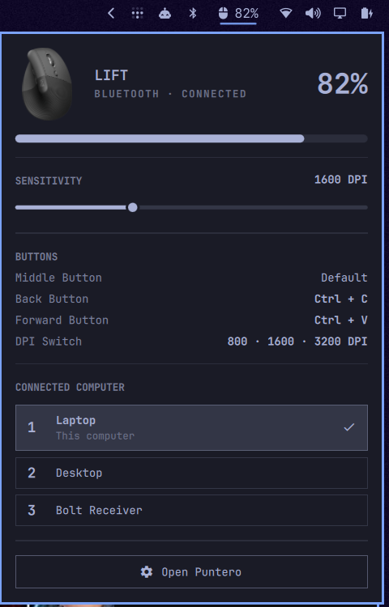

# Puntero

**English** · [Español](README.es.md)

A modern, free app to configure **Logitech** mice and keyboards on Linux.
It uses [Solaar](https://github.com/pwr-Solaar/Solaar) as its engine, with a GTK4 + libadwaita interface.



<sub>The screenshots show a photo of the mouse added as a [custom image](#custom-images); without it, Puntero shows an illustration.</sub>

## Features

- **Battery** shown big, with charging status.
- **Sensitivity (DPI)** with a slider.
- **Buttons your way**: each button can be
  - another mouse button,
  - a **keyboard shortcut** (a letter, `Ctrl+C`, `Ctrl+Shift+T`, media keys…),
  - a **full text** typed wherever the cursor is (a greeting, a signature, your email…),
  - a **command**,
  - a **DPI cycle**: several preset steps that change with each press
    (for example 800 → 1600 → 3200), with an on-screen indicator.
- **Easy-Switch**: move the mouse to another paired computer, with confirmation.
- **Runs in the background**: shortcuts keep working with the window closed.
- **Bar plugin for [Omarchy](https://omarchy.org)**: battery in the bar and a panel with
  DPI, buttons and Easy-Switch.
- **In English and Spanish**: follows the system language, or the one you pick in the app menu.
- Works on Wayland and X11 and with any desktop (GNOME, KDE, Hyprland, Sway…).
- Compatible with Solaar's configuration: they share the same settings file.

| Keyboard shortcuts | Text on a button | DPI cycle |
|---|---|---|
|  |  |  |

### Omarchy bar plugin



Battery in the bar and, one click away, a panel with the sensitivity, what each button does and
the computer connected through Easy-Switch.

## Requirements

- Linux with **systemd** (the background service is a systemd user service).
- **Solaar 1.1.20** or similar (Puntero uses Solaar internals; very different versions might
  break something, and the installer warns about it).
- **GTK 4** and **libadwaita 1.7 or newer** (Arch, Fedora 42+, Ubuntu 25.04+…).
- **python-evdev** (to simulate the shortcut keys).
- Optional: **wtype** (Wayland) or **xdotool** (X11) to type texts with accents and symbols
  from a button. Without them only plain letters, numbers and spaces are typed.

Tested with a Logitech **LIFT** over Bluetooth. It should work with any device Solaar
recognizes; if you try it with another model, please tell us in an *issue*.

## Installation

### Arch Linux and derivatives

Coming soon to the AUR (`yay -S puntero`). Meanwhile, install the same package from this
repository:

```
git clone https://github.com/luisalgomez111/puntero.git
cd puntero/packaging/aur
makepkg -si
puntero --setup
```

`puntero --setup` starts the service and, on Omarchy, adds the plugin to the bar. Then turn the
mouse off and on so Solaar's permissions apply. Before removing the package, run
`puntero --reset` to give the buttons back their default function.

### Any distribution (installer)

1. Install the dependencies. If something is missing, the installer tells you the exact command
   for your distribution (`pacman`, `apt`, `dnf` or `zypper`). On Arch, for example:

   ```
   sudo pacman -S --needed solaar python-evdev python-gobject gtk4 libadwaita
   sudo udevadm control --reload && sudo udevadm trigger
   ```

   Then turn the mouse off and on so the permissions apply.

2. Download Puntero and run the installer:

   ```
   git clone https://github.com/luisalgomez111/puntero.git
   cd puntero
   ./install.sh
   ```

The installer sets everything up for your user:

- copies the program to `~/.local/share/puntero`;
- creates the `puntero` command and the app menu entry;
- installs and starts the `puntero.service` service;
- on Omarchy, installs the bar plugin and places it next to Bluetooth.

You can run it several times without duplicating anything. `./install.sh --dev` uses the
repository folder as is (handy for development).

## Usage

Open **Puntero** from the app menu or with `puntero`. On Omarchy you also get the mouse icon in
the bar: left click opens the quick panel and right click opens the app.

### Keyboard shortcuts on buttons

The mouse itself can only swap one mouse button for another. To make a button send a shortcut,
Puntero **diverts** it: the mouse reports the press and the service simulates the keys through
`/dev/uinput`. That's why shortcuts work while the service is running (it starts with your
session).

If Hyprland or another desktop grabs a **Super** combination before Puntero sees it, turn on the
**Super** toggle in the editor and record only the other key.

### Text on a button

In the **Text** tab of the button editor, write what you want typed when you press it; it can
have several lines. It's typed wherever the cursor is, as if you typed it yourself. With
**wtype** or **xdotool** installed, any character works, whatever your keyboard layout.

### Language

Puntero is available in **English** and **Spanish**. By default it follows the system language
(Spanish if your system is in Spanish, English otherwise). To change it, open the **☰** menu in
the sidebar and choose **Language**. The app and the bar plugin restart in the new language.

### Custom images

Puntero ships its own illustrations. To see a photo of your mouse, save it as
`~/.config/puntero/images/<name>.png` (also `.svg`, `.webp` or `.jpg`), where `<name>` is the
short device name as shown in the app, for example `LIFT.png`.

## Uninstall

```
./uninstall.sh          # keeps your configuration (~/.config/puntero)
./uninstall.sh --purge  # also removes the configuration and images
```

Before stopping the service it gives the buttons back their default function. Saved shortcuts
are kept and applied again automatically if you reinstall.

## How it's built

- `puntero/backend.py`: background service (`puntero.service`). It uses `logitech_receiver` and
  `solaar.listener` and listens on `$XDG_RUNTIME_DIR/puntero.sock` with a one-JSON-line-per-message
  protocol. It runs apart from the interface because Solaar loads GTK3, which can't live with
  GTK4 in the same process.
- `puntero/buttons.py`: shortcuts, texts, commands and DPI cycle on buttons (HID++ diversion and
  keys simulated with uinput). Saved in `~/.config/puntero/buttons.json`.
- `puntero/i18n.py` and `puntero/lang_en.py`: languages. Texts are written in Spanish and
  `lang_en.py` holds their English translation; the service translates the data before sending it.
- `puntero/app.py`: the GTK4 interface; it starts the service if it isn't running.
- `omarchy-plugin/`: Omarchy bar widget (QML), connected to the same socket;
  `data/omarchy-plugin.sh` adds it to or removes it from the bar. After editing its QML you need
  `omarchy restart shell`.
- `packaging/aur/`: the AUR package `PKGBUILD`.
- Mouse settings are stored in `~/.config/solaar/config.yaml`, the same file Solaar uses.

## Support the project

Puntero is free software. If you find it useful and want to support its development, you can
donate through **Binance Pay**:

**Binance Pay ID: `368493246`**

In the Binance app go to **Pay**, choose send and enter the Pay ID. Thank you! 💙

## License

Puntero is free software under the **GNU GPL v3 or later** license (see [LICENSE](LICENSE)).
It uses Solaar, which is distributed under the GPL v2 or later.

Puntero is an independent project and is not affiliated with Logitech. Logitech, LIFT and
Easy-Switch are trademarks of Logitech; they are mentioned only to indicate compatibility.
