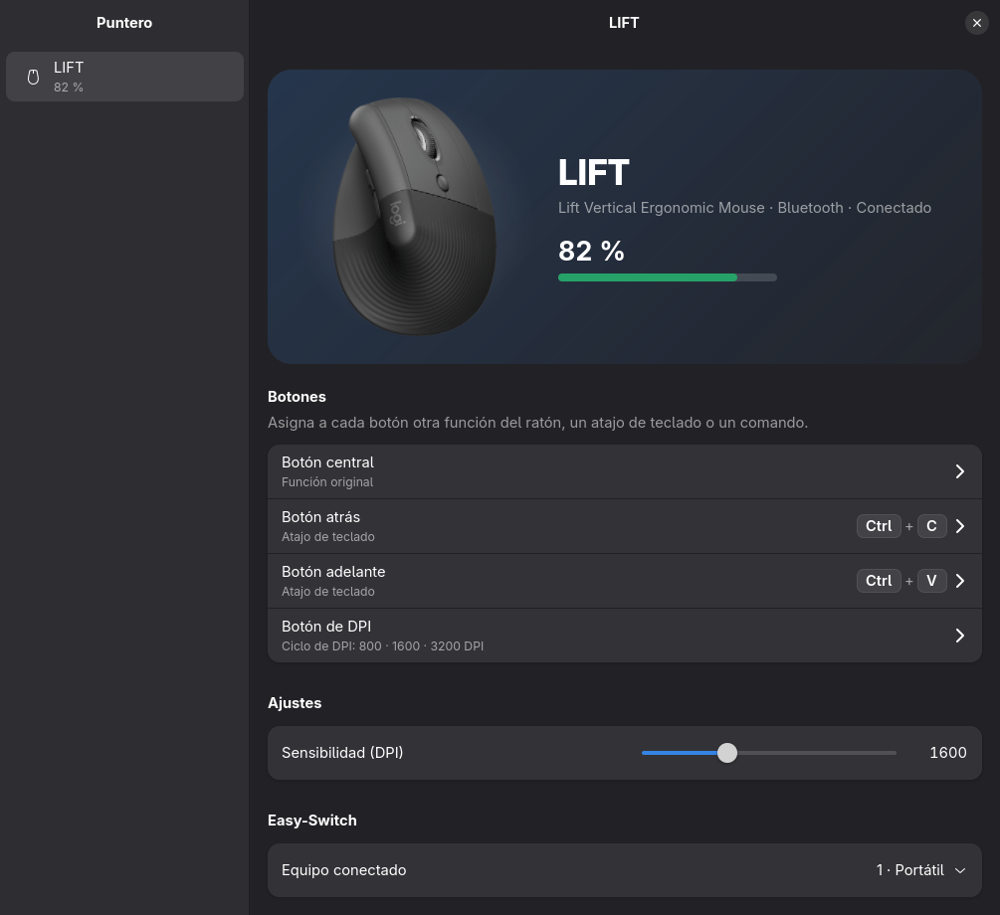
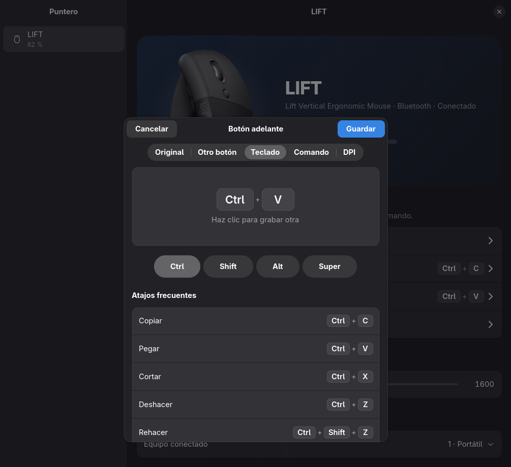
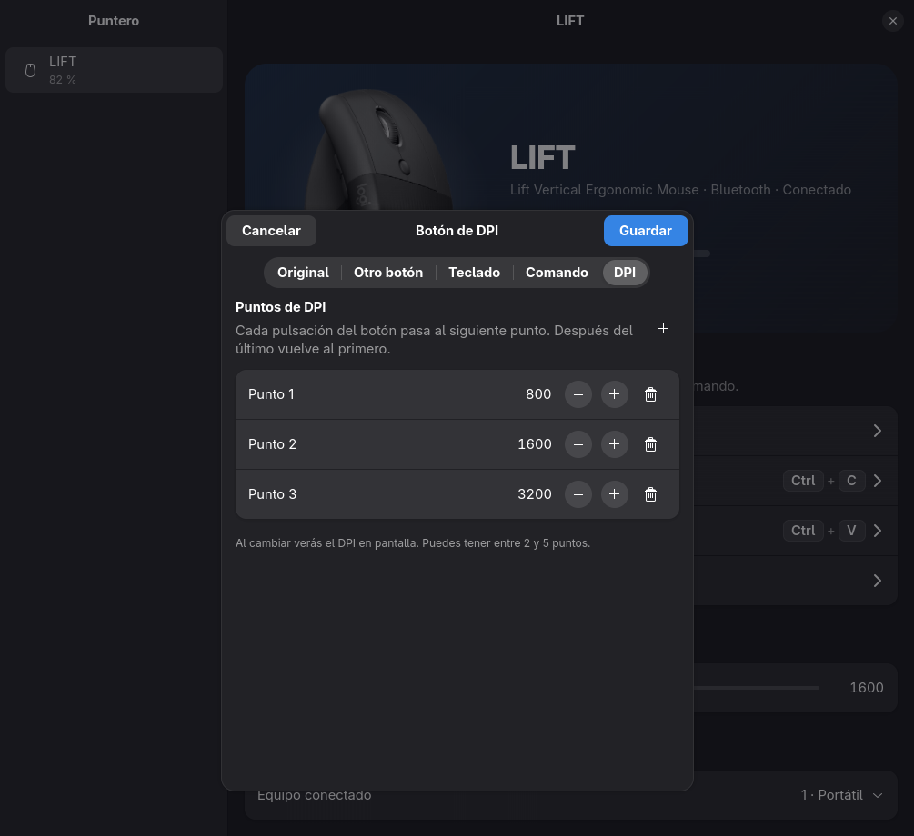

# Puntero

Una app moderna y libre para configurar ratones y teclados **Logitech** en Linux.
Usa [Solaar](https://github.com/pwr-Solaar/Solaar) como motor y una interfaz GTK4 + libadwaita.



<sub>En las capturas se ve la foto del ratón añadida como [imagen propia](#imágenes-propias); sin ella, Puntero muestra una ilustración.</sub>

## Qué hace

- **Batería** en grande, con aviso de carga.
- **Sensibilidad (DPI)** con un deslizador.
- **Botones a tu gusto**: cada botón puede ser
  - otro botón del ratón,
  - un **atajo de teclado** (una letra, `Ctrl+C`, `Ctrl+Shift+T`, teclas multimedia…),
  - un **comando**,
  - un **ciclo de DPI**: varios puntos preconfigurados que se recorren con cada pulsación
    (por ejemplo 800 → 1600 → 3200), con aviso en pantalla.
- **Easy-Switch**: pasar el ratón a otro equipo emparejado, con confirmación.
- **Funciona en segundo plano**: los atajos siguen activos con la ventana cerrada.
- **Plugin para la barra de [Omarchy](https://omarchy.org)**: batería en la barra y un panel con
  DPI, botones y Easy-Switch.
- Funciona en Wayland y X11 y con cualquier escritorio (GNOME, KDE, Hyprland, Sway…).
- Compatible con la configuración de Solaar: comparten el mismo archivo de ajustes.

| Atajos de teclado | Ciclo de DPI |
|---|---|
|  |  |

## Requisitos

- Linux con **systemd** (el servicio en segundo plano es de systemd).
- **Solaar 1.1.20** o parecido (Puntero usa partes internas de Solaar; con versiones muy distintas
  algo podría fallar, y el instalador avisa).
- **GTK 4** y **libadwaita 1.7 o superior** (Arch, Fedora 42+, Ubuntu 25.04+…).
- **python-evdev** (para simular las teclas de los atajos).

Probado con un Logitech **LIFT** por Bluetooth. Debería funcionar con cualquier dispositivo que
Solaar reconozca; si lo pruebas con otro modelo, cuéntalo en un *issue*.

## Instalación

1. Instala las dependencias. El instalador te dice el comando exacto para tu distribución
   (`pacman`, `apt`, `dnf` o `zypper`) si falta algo. En Arch, por ejemplo:

   ```
   sudo pacman -S --needed solaar python-evdev python-gobject gtk4 libadwaita
   sudo udevadm control --reload && sudo udevadm trigger
   ```

   Después apaga y enciende el ratón para que se apliquen los permisos.

2. Descarga Puntero y ejecuta el instalador:

   ```
   git clone https://github.com/luisalgomez111/puntero.git
   cd puntero
   ./install.sh
   ```

El instalador deja todo listo para tu usuario:

- copia el programa a `~/.local/share/puntero`;
- crea el comando `puntero` y el acceso en el menú de apps;
- instala y arranca el servicio `puntero.service`;
- si usas Omarchy, instala el plugin de la barra y lo pone junto al Bluetooth.

Puedes ejecutarlo varias veces sin duplicar nada. Con `./install.sh --dev` usa la carpeta del
repositorio tal cual (útil para desarrollar).

## Uso

Abre **Puntero** desde el menú de apps o con `puntero`. En Omarchy también tienes el icono del
ratón en la barra: clic izquierdo abre el panel rápido y clic derecho abre la app.

### Atajos de teclado en los botones

El ratón solo sabe cambiar un botón por otro botón del ratón. Para que un botón lance un atajo,
Puntero lo **desvía**: el ratón avisa de la pulsación y el servicio simula las teclas con
`/dev/uinput`. Por eso los atajos funcionan mientras el servicio está activo (arranca solo con la
sesión).

Si Hyprland u otro escritorio se queda una combinación con **Super** antes de que Puntero la vea,
activa el botón **Super** en el editor y graba solo la otra tecla.

### Imágenes propias

Puntero incluye ilustraciones propias. Si quieres ver la foto de tu ratón, guárdala como
`~/.config/puntero/images/<nombre>.png` (también `.svg`, `.webp` o `.jpg`), donde `<nombre>` es el
nombre corto del dispositivo tal como aparece en la app, por ejemplo `LIFT.png`.

## Desinstalación

```
./uninstall.sh          # conserva tu configuración (~/.config/puntero)
./uninstall.sh --purge  # también borra la configuración y las imágenes
```

Antes de detener el servicio devuelve los botones a su función original. Los atajos guardados se
conservan y se vuelven a aplicar solos si reinstalas.

## Cómo está hecho

- `puntero/backend.py`: servicio en segundo plano (`puntero.service`). Usa `logitech_receiver` y
  `solaar.listener` y escucha en `$XDG_RUNTIME_DIR/puntero.sock` con un protocolo de una línea JSON
  por mensaje. Corre aparte de la interfaz porque Solaar carga GTK3, que no puede convivir con
  GTK4 en el mismo proceso.
- `puntero/buttons.py`: atajos, comandos y ciclo de DPI en los botones (desvío por HID++ y teclas
  simuladas con uinput). Se guardan en `~/.config/puntero/buttons.json`.
- `puntero/i18n.py`: textos en español; el servicio los aplica antes de enviar los datos.
- `puntero/app.py`: la interfaz GTK4; si el servicio no está en marcha, lo arranca.
- `omarchy-plugin/`: widget de barra para Omarchy (QML), conectado al mismo socket.
  Tras editar su QML hace falta `omarchy restart shell`.
- Los ajustes del ratón se guardan en `~/.config/solaar/config.yaml`, el mismo archivo que usa Solaar.

## Apoya el proyecto

Puntero es libre y gratuito. Si te resulta útil y quieres apoyar su desarrollo, puedes hacer una
donación por **Binance Pay**:

**Binance Pay ID: `368493246`**

En la app de Binance entra en **Pay**, elige enviar y escribe el Pay ID. ¡Gracias! 💙

## Licencia

Puntero es software libre bajo la licencia **GNU GPL v3 o posterior** (ver [LICENSE](LICENSE)).
Usa Solaar, que se distribuye bajo GPL v2 o posterior.

Puntero es un proyecto independiente y no tiene relación con Logitech. Logitech, LIFT y
Easy-Switch son marcas de Logitech; se nombran solo para indicar compatibilidad.
